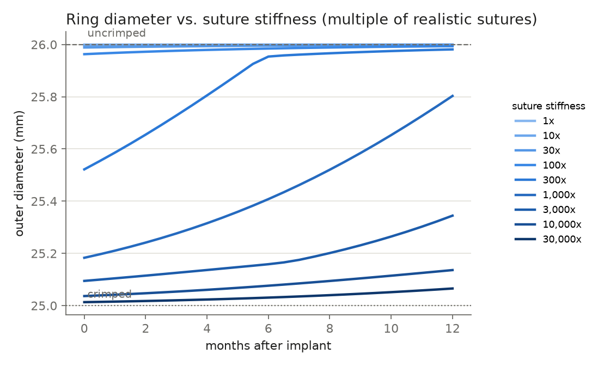
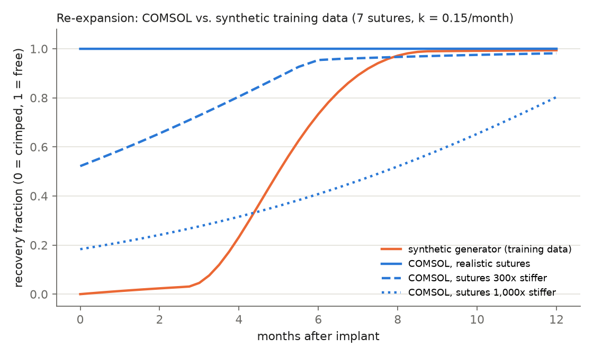
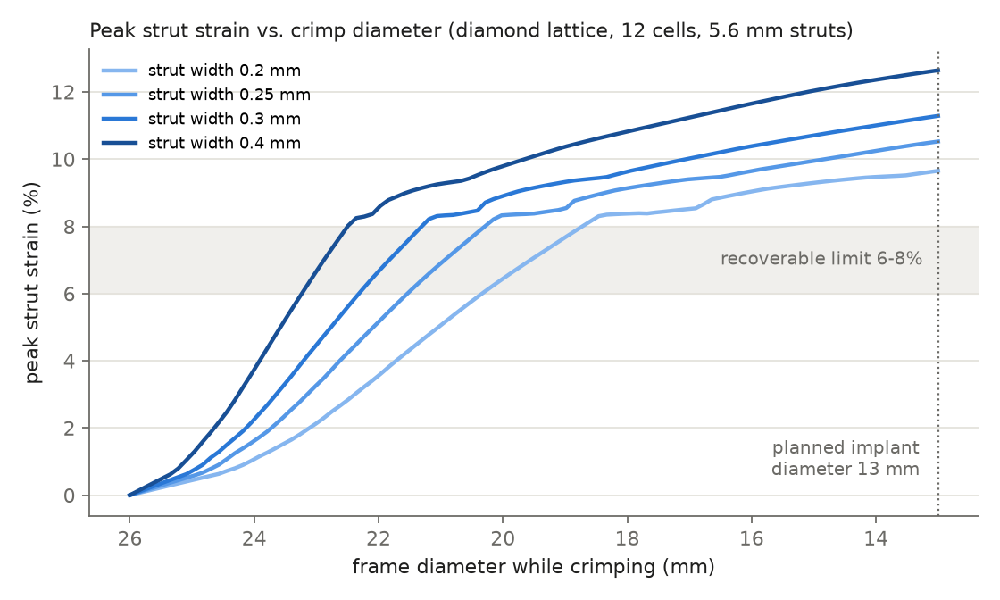

# COMSOL nitinol ring: crimp, hand-over to sutures, suture dissolution

Auto-generated by `experiments/comsol_ring_analysis.py` from `data/comsol/comsol_ring_runs.csv`.
Model and run procedure: `experiments/comsol/README.md`.

## Suture-stiffness sweep (7 sutures, k_diss = 0.15/month, mesh 8x20)

| case | D_crimped_mm | max_xi_crimped | D_implant_mm | D_month12_mm | expansion_0_12_mm | recovered_at_implant | suture_pressure_implant_MPa |
| --- | ---: | ---: | ---: | ---: | ---: | ---: | ---: |
| K1 | 25.000 | 0.575 | 26.000 | 26.000 | 0.0003 | 1.000 | 0.121 |
| K10 | 25.000 | 0.575 | 25.996 | 25.999 | 0.0032 | 0.996 | 1.207 |
| K30 | 25.000 | 0.575 | 25.989 | 25.998 | 0.0095 | 0.989 | 3.593 |
| K100 | 25.000 | 0.575 | 25.963 | 25.994 | 0.0307 | 0.963 | 11.668 |
| K300 | 25.000 | 0.575 | 25.522 | 25.981 | 0.4596 | 0.522 | 18.965 |
| K1000 | 25.000 | 0.575 | 25.183 | 25.803 | 0.6199 | 0.183 | 22.196 |
| K3000 | 25.000 | 0.575 | 25.095 | 25.345 | 0.2499 | 0.095 | 34.398 |
| K10000 | 25.000 | 0.575 | 25.037 | 25.136 | 0.0995 | 0.037 | 44.333 |
| K30000 | 25.000 | 0.575 | 25.013 | 25.066 | 0.0523 | 0.013 | 48.299 |

## Mesh convergence (radial x axial quadratic elements)

| case | D_crimped_mm | max_xi_crimped | D_implant_mm | D_month12_mm | expansion_0_12_mm | recovered_at_implant | suture_pressure_implant_MPa |
| --- | ---: | ---: | ---: | ---: | ---: | ---: | ---: |
| mesh4x10_K1 | 25.000 | 0.575 | 26.000 | 26.000 | 0.0003 | 1.000 | 0.121 |
| K1 | 25.000 | 0.575 | 26.000 | 26.000 | 0.0003 | 1.000 | 0.121 |
| mesh16x40_K1 | 25.000 | 0.575 | 26.000 | 26.000 | 0.0003 | 1.000 | 0.121 |
| mesh4x10_K1000 | 25.000 | 0.575 | 25.183 | 25.803 | 0.6199 | 0.183 | 22.197 |
| K1000 | 25.000 | 0.575 | 25.183 | 25.803 | 0.6199 | 0.183 | 22.196 |
| mesh16x40_K1000 | 25.000 | 0.575 | 25.183 | 25.803 | 0.6199 | 0.183 | 22.197 |

Rows without a `mesh` prefix use the production mesh (8x20).

## Design sweep, realistic sutures: suture count x dissolution rate

| case | D_crimped_mm | max_xi_crimped | D_implant_mm | D_month12_mm | expansion_0_12_mm | recovered_at_implant | suture_pressure_implant_MPa |
| --- | ---: | ---: | ---: | ---: | ---: | ---: | ---: |
| design_N4_k0.05_K1 | 25.000 | 0.575 | 26.000 | 26.000 | 0.0001 | 1.000 | 0.069 |
| design_N4_k0.1_K1 | 25.000 | 0.575 | 26.000 | 26.000 | 0.0002 | 1.000 | 0.069 |
| design_N4_k0.2_K1 | 25.000 | 0.575 | 26.000 | 26.000 | 0.0002 | 1.000 | 0.069 |
| design_N4_k0.3_K1 | 25.000 | 0.575 | 26.000 | 26.000 | 0.0002 | 1.000 | 0.069 |
| design_N6_k0.05_K1 | 25.000 | 0.575 | 26.000 | 26.000 | 0.0001 | 1.000 | 0.104 |
| design_N6_k0.1_K1 | 25.000 | 0.575 | 26.000 | 26.000 | 0.0002 | 1.000 | 0.104 |
| design_N6_k0.2_K1 | 25.000 | 0.575 | 26.000 | 26.000 | 0.0003 | 1.000 | 0.104 |
| design_N6_k0.3_K1 | 25.000 | 0.575 | 26.000 | 26.000 | 0.0003 | 1.000 | 0.104 |
| design_N8_k0.05_K1 | 25.000 | 0.575 | 26.000 | 26.000 | 0.0002 | 1.000 | 0.138 |
| design_N8_k0.1_K1 | 25.000 | 0.575 | 26.000 | 26.000 | 0.0003 | 1.000 | 0.138 |
| design_N8_k0.2_K1 | 25.000 | 0.575 | 26.000 | 26.000 | 0.0004 | 1.000 | 0.138 |
| design_N8_k0.3_K1 | 25.000 | 0.575 | 26.000 | 26.000 | 0.0004 | 1.000 | 0.138 |
| design_N10_k0.05_K1 | 25.000 | 0.575 | 25.999 | 26.000 | 0.0002 | 0.999 | 0.173 |
| design_N10_k0.1_K1 | 25.000 | 0.575 | 25.999 | 26.000 | 0.0004 | 0.999 | 0.173 |
| design_N10_k0.2_K1 | 25.000 | 0.575 | 25.999 | 26.000 | 0.0005 | 0.999 | 0.173 |
| design_N10_k0.3_K1 | 25.000 | 0.575 | 25.999 | 26.000 | 0.0005 | 0.999 | 0.173 |

## Design sweep, sutures 1000x stiffer (controlled-expansion regime): suture count x dissolution rate

| case | D_crimped_mm | max_xi_crimped | D_implant_mm | D_month12_mm | expansion_0_12_mm | recovered_at_implant | suture_pressure_implant_MPa |
| --- | ---: | ---: | ---: | ---: | ---: | ---: | ---: |
| design_N4_k0.05_K1000 | 25.000 | 0.575 | 25.304 | 25.504 | 0.1998 | 0.304 | 21.072 |
| design_N4_k0.1_K1000 | 25.000 | 0.575 | 25.304 | 25.782 | 0.4777 | 0.304 | 21.072 |
| design_N4_k0.2_K1000 | 25.000 | 0.575 | 25.304 | 25.981 | 0.6761 | 0.304 | 21.072 |
| design_N4_k0.3_K1000 | 25.000 | 0.575 | 25.304 | 25.994 | 0.6897 | 0.304 | 21.072 |
| design_N6_k0.05_K1000 | 25.000 | 0.575 | 25.211 | 25.361 | 0.1493 | 0.211 | 21.939 |
| design_N6_k0.1_K1000 | 25.000 | 0.575 | 25.211 | 25.586 | 0.3749 | 0.211 | 21.939 |
| design_N6_k0.2_K1000 | 25.000 | 0.575 | 25.211 | 25.971 | 0.7598 | 0.211 | 21.939 |
| design_N6_k0.3_K1000 | 25.000 | 0.575 | 25.211 | 25.991 | 0.7799 | 0.211 | 21.939 |
| design_N8_k0.05_K1000 | 25.000 | 0.575 | 25.164 | 25.280 | 0.1160 | 0.164 | 22.765 |
| design_N8_k0.1_K1000 | 25.000 | 0.575 | 25.164 | 25.468 | 0.3035 | 0.164 | 22.765 |
| design_N8_k0.2_K1000 | 25.000 | 0.575 | 25.164 | 25.962 | 0.7973 | 0.164 | 22.765 |
| design_N8_k0.3_K1000 | 25.000 | 0.575 | 25.164 | 25.988 | 0.8238 | 0.164 | 22.765 |
| design_N10_k0.05_K1000 | 25.000 | 0.575 | 25.147 | 25.229 | 0.0825 | 0.147 | 25.405 |
| design_N10_k0.1_K1000 | 25.000 | 0.575 | 25.147 | 25.389 | 0.2422 | 0.147 | 25.405 |
| design_N10_k0.2_K1000 | 25.000 | 0.575 | 25.147 | 25.934 | 0.7871 | 0.147 | 25.405 |
| design_N10_k0.3_K1000 | 25.000 | 0.575 | 25.147 | 25.985 | 0.8385 | 0.147 | 25.405 |

## Material sensitivity (sutures 1000x, 7 sutures, k_diss 0.15/month)

Baseline is `K1000` (Af 298.15 K, E_A 47 GPa, max transformation strain 0.06); each row changes one value.

| case | D_crimped_mm | max_xi_crimped | D_implant_mm | D_month12_mm | expansion_0_12_mm | recovered_at_implant | suture_pressure_implant_MPa |
| --- | ---: | ---: | ---: | ---: | ---: | ---: | ---: |
| K1000 | 25.000 | 0.575 | 25.183 | 25.803 | 0.6199 | 0.183 | 22.196 |
| mat_Af293_K1000 | 25.000 | 0.575 | 25.204 | 25.940 | 0.7357 | 0.204 | 24.758 |
| mat_Af303_K1000 | 25.000 | 0.575 | 25.173 | 25.660 | 0.4866 | 0.173 | 20.963 |
| mat_EA60_K1000 | 25.000 | 0.584 | 25.185 | 25.812 | 0.6270 | 0.185 | 22.442 |
| mat_etr5_K1000 | 25.000 | 0.665 | 25.196 | 25.819 | 0.6233 | 0.196 | 23.689 |

## Cross-check: 3D lattice-stiffness sweep run in the COMSOL desktop

From `data/comsol/comsol_2026-10-08_flat_sweep_0.005-0.0001.csv`, `data/comsol/comsol_2026-10-08_flat_sweep_1-0.001.csv` (3D model run by hand; `f_lat` is a lattice stiffness factor on the ring; k_diss 0.3/month, inferred from the suture-force decay).

| f_lat | D month 0 (mm) | D month 12 (mm) | max martensite | suture force month 0 (N) |
| ---: | ---: | ---: | ---: | ---: |
| 1 | 26.000 | 26.000 | -1.8e-07 | 49.6 |
| 0.1 | 25.996 | 26.000 | 0.0e+00 | 49.4 |
| 0.01 | 25.963 | 25.999 | 0.0e+00 | 47.7 |
| 0.005 | 25.928 | 25.998 | 0.0e+00 | 46.0 |
| 0.002 | 25.838 | 25.995 | 0.0e+00 | 41.5 |
| 0.001 | 25.719 | 25.990 | 0.0e+00 | 35.6 |
| 0.0005 | 25.559 | 25.979 | 0.0e+00 | 27.7 |
| 0.0002 | 25.333 | 25.950 | 0.0e+00 | 16.5 |
| 0.0001 | 25.198 | 25.905 | 0.0e+00 | 9.8 |

The `f_lat = 1` suture force at month 0 matches this axisymmetric model's `K1` case (49.5 N = suture pressure x outer area). Martensite is zero in every `f_lat` run, so that expansion is elastic springback of a softened ring, not superelastic recovery.

## Design sweep in the 3D model at f_lat = 0.0002 (elastic lattice stand-in) vs. the shape-memory regime

From `data/comsol/comsol_2026-10-09_main_sweep_flat0.0002.csv`. D in mm; the K1000 columns are the axisymmetric `design_N*_k*_K1000` case.

| N_sut | k_diss | D month 0, f_lat | D month 0, K1000 | D month 12, f_lat | D month 12, K1000 |
| ---: | ---: | ---: | ---: | ---: | ---: |
| 4 | 0.05 | 25.468 | 25.304 | 25.618 | 25.504 |
| 4 | 0.1 | 25.468 | 25.304 | 25.749 | 25.782 |
| 4 | 0.2 | 25.468 | 25.304 | 25.909 | 25.981 |
| 4 | 0.3 | 25.468 | 25.304 | 25.971 | 25.994 |
| 6 | 0.05 | 25.368 | 25.211 | 25.518 | 25.361 |
| 6 | 0.1 | 25.368 | 25.211 | 25.664 | 25.586 |
| 6 | 0.2 | 25.368 | 25.211 | 25.869 | 25.971 |
| 6 | 0.3 | 25.368 | 25.211 | 25.957 | 25.991 |
| 8 | 0.05 | 25.303 | 25.164 | 25.445 | 25.280 |
| 8 | 0.1 | 25.303 | 25.164 | 25.596 | 25.468 |
| 8 | 0.2 | 25.303 | 25.164 | 25.833 | 25.962 |
| 8 | 0.3 | 25.303 | 25.164 | 25.943 | 25.988 |
| 10 | 0.05 | 25.258 | 25.147 | 25.390 | 25.229 |
| 10 | 0.1 | 25.258 | 25.147 | 25.540 | 25.389 |
| 10 | 0.2 | 25.258 | 25.147 | 25.799 | 25.934 |
| 10 | 0.3 | 25.258 | 25.147 | 25.930 | 25.985 |

Martensite is zero throughout the f_lat sweep (elastic recovery); in the K1000 sweep the ring is still partly martensitic at implant (superelastic recovery).

## Lattice cell: peak strut strain during a 26 -> 13 mm crimp

Quarter of one diamond cell (12 cells around, 5.6 mm struts, plane stress, 0.4 mm thick), filleted X-junctions, Lagoudas SMA at 37 C, geometric nonlinearity. Model: `experiments/comsol/LatticeCell.java.template`; data: `data/comsol/comsol_cell_runs.csv`.

| case | cells around | strut length (mm) | strut width, junction -> middle (mm) | fillet (mm) | mesh (elements per width) | peak strain at 13 mm | D where strain passes 6% (mm) | passes 8% (mm) | max martensite | hoop force per cell row (N) |
| --- | ---: | ---: | ---: | ---: | ---: | ---: | ---: | ---: | ---: | ---: |
| base | 12 | 5.6 | 0.4 | 0.2 | 8 | 12.6% | 23.1 | 22.5 | 1.00 | 32.6 |
| mesh4 | 12 | 5.6 | 0.4 | 0.2 | 4 | 12.6% | 23.1 | 22.5 | 1.00 | 33.3 |
| mesh16 | 12 | 5.6 | 0.4 | 0.2 | 16 | 12.9% | 23.3 | 22.5 | 1.00 | 33.3 |
| rf0.3 | 12 | 5.6 | 0.4 | 0.3 | 8 | 12.7% | 23.0 | 22.2 | 1.00 | 29.7 |
| w0.3 | 12 | 5.6 | 0.3 | 0.15 | 8 | 11.3% | 22.2 | 21.2 | 1.00 | 20.1 |
| w0.2 | 12 | 5.6 | 0.2 | 0.1 | 8 | 9.7% | 20.3 | 18.7 | 1.00 | 11.1 |
| w0.25 | 12 | 5.6 | 0.25 | 0.125 | 8 | 10.5% | 21.4 | 20.3 | 1.00 | 15.3 |
| N18_w0.2 | 18 | 5.6 | 0.2 | 0.1 | 6 | 8.6% | 17.6 | 15.5 | 1.00 | 2.4 |
| N18_w0.3 | 18 | 5.6 | 0.3 | 0.15 | 6 | 10.4% | 20.8 | 19.4 | 1.00 | 5.3 |
| N24_w0.2 | 24 | 5.6 | 0.2 | 0.1 | 6 | 8.4% | 16.1 | 13.7 | 1.00 | 1.3 |
| N24_w0.3 | 24 | 5.6 | 0.3 | 0.15 | 6 | 10.1% | 20.0 | 18.6 | 1.00 | 3.8 |
| L8_w0.25 | 12 | 8 | 0.25 | 0.125 | 6 | 8.4% | 16.5 | 14.0 | 1.00 | 3.2 |
| L10_w0.25 | 12 | 10 | 0.25 | 0.125 | 6 | 5.2% | never | never | 0.64 | 1.2 |
| L10_w0.25_mesh12 | 12 | 10 | 0.25 | 0.125 | 12 | 5.0% | never | never | 0.61 | 1.2 |
| L10_w0.25_rf0.2 | 12 | 10 | 0.25 | 0.2 | 6 | 5.1% | never | never | 0.62 | 1.1 |
| taper_ctrl_0.4-0.4 | 12 | 5.6 | 0.4 | 0.2 | 6 | 12.7% | 23.1 | 22.5 | 1.00 | 32.7 |
| taper_0.4-0.2 | 12 | 5.6 | 0.4 -> 0.2 | 0.2 | 6 | 8.8% | 19.0 | 16.2 | 1.00 | 20.5 |
| taper_0.5-0.2 | 12 | 5.6 | 0.5 -> 0.2 | 0.25 | 6 | 8.6% | 17.4 | 14.3 | 1.00 | 24.7 |
| taper_0.6-0.2 | 12 | 5.6 | 0.6 -> 0.2 | 0.3 | 6 | 8.9% | 19.1 | 16.5 | 1.00 | 29.5 |
| taper_0.4-0.15 | 12 | 5.6 | 0.4 -> 0.15 | 0.2 | 6 | 6.5% | 14.2 | never | 0.82 | 17.7 |
| taper_0.5-0.15 | 12 | 5.6 | 0.5 -> 0.15 | 0.25 | 6 | 8.4% | 17.9 | 14.6 | 1.00 | 21.1 |
| taper_0.4-0.12 | 12 | 5.6 | 0.4 -> 0.12 | 0.2 | 6 | 7.1% | 15.6 | never | 0.90 | 15.7 |

Cases whose peak strain passes 6% are not given a recovery result: the material model caps transformation strain at 6% and has no plasticity, so its spring-back after such a crimp is not physical (real nitinol would take a permanent set). Cases with a 0.1 mm fillet and a 0.5 mm strut on the 12-cell, 5.6 mm geometry did not converge and are excluded.

Where the peak sits (original 12-cell, 5.6 mm, 0.4 mm design at 13 mm): 12.6% at 0.5-1 mm from the junction centre, where the strut meets the junction; 12.3% inside the junction, 8.9% at 1-2 mm and 0.5% in the middle of the strut. Bending concentrates at the strut roots, which is why strut width and fillet radius change the peak so little.

Borderline: `taper_0.4-0.15` reaches 6.5% at 13 mm, inside the 6-8% band (passes 6% at 14.2 mm). Its release is reported in the CSV but is less certain, because the material model caps transformation strain at 6%.

Borderline: `taper_0.4-0.12` reaches 7.1% at 13 mm, inside the 6-8% band (passes 6% at 15.6 mm). Its release is reported in the CSV but is less certain, because the material model caps transformation strain at 6%.

Designs that stay under 6% for the full 26 -> 13 mm crimp, with release back to free size:

- `L10_w0.25`: 12 cells, 10 mm struts (0.25 mm at the junction, 0.25 mm at mid-length), peak strain 5.2%, recovers to 26.00 mm, hoop force per row at 13 mm 1.2 N.
- `L10_w0.25_mesh12`: 12 cells, 10 mm struts (0.25 mm at the junction, 0.25 mm at mid-length), peak strain 5.0%, recovers to 26.00 mm, hoop force per row at 13 mm 1.2 N.
- `L10_w0.25_rf0.2`: 12 cells, 10 mm struts (0.25 mm at the junction, 0.25 mm at mid-length), peak strain 5.1%, release did not converge, hoop force per row at 13 mm 1.1 N.

## Figures

